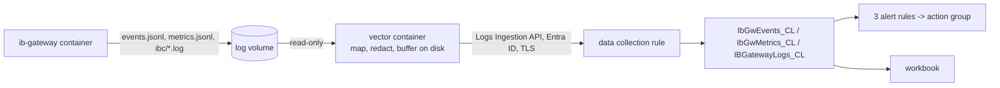

# Azure Log Analytics pack

Ship the gateway's events, metrics and (opt-in, redacted) raw logs to **your own** Azure Log
Analytics workspace, with three alert rules and a workbook. One `az deployment group create`,
one compose profile. Nothing here gives anyone but you access to anything.



Contents: [Set-up](#set-up) · [One-click VM](#one-click-vm-optional) · [What is shipped](#what-is-and-is-not-shipped) ·
[Alerts](#alerts) · [Queries](#queries) · [Latency](#latency) · [Cost](#cost) · [Limits](#limits) ·
[Security](#security) · [Troubleshooting](#troubleshooting) · [Other destinations](#other-destinations) · [Tests](#tests)

## Set-up

You need the Azure CLI (`az login` done), a resource group, and Docker on the gateway host.
Commands run from the repository root.

### 1. Deploy

Copy `azure/bicep/main.bicepparam`, fill in the placeholders (alert e-mail, maintenance window;
leave `ingestPrincipalId` empty for now if you do not have the identity yet), then:

```bash
az deployment group create -g <resource-group> -n main \
  -f azure/bicep/main.bicep -p <your-copy>.bicepparam
az deployment group show -g <resource-group> -n main --query properties.outputs
```

You should see `"provisioningState": "Succeeded"` and the outputs `logsIngestionEndpoint`
(`https://...ingest.monitor.azure.com`), `dcrImmutableId` (`dcr-` + 32 hex), `tenantId` and
`dcrResourceId`.

### 2. Choose the identity that ships

**A. Gateway on an Azure VM: managed identity (no secret at all).** Give the VM a
system-assigned identity and pass its object id as `ingestPrincipalId` (redeploy step 1):

```bash
az vm identity assign -g <vm-resource-group> -n <vm-name> --query systemAssignedIdentity -o tsv
```

**B. Windows (Docker Desktop) or on-premises: Entra application with a certificate.**

```bash
# App + service principal + self-signed certificate; no role is assigned by this command.
az ad sp create-for-rbac --name ibgw-log-shipper --create-cert --years 1
#   note "appId", "tenant" and "fileWithCertAndPrivateKey" (a .pem file in your home directory)
az ad sp show --id <appId> --query id -o tsv      # object id -> ingestPrincipalId, redeploy step 1
# PEM -> passwordless PKCS#12 for Vector (Git for Windows ships openssl), then delete the PEM.
openssl pkcs12 -export -in <fileWithCertAndPrivateKey> -out compose/secrets/azure-client-cert.pfx -passout pass:
```

You should see, after the redeployment, one role assignment on the data collection rule:
`az role assignment list --scope <dcrResourceId> -o table` shows *Monitoring Metrics Publisher*
for your identity and nothing else. The private key lives only in
`compose/secrets/azure-client-cert.pfx` (git-ignored; on Linux make it readable by uid 1000 only).
A client secret would also work with Vector, but it is a password in a file that expires
silently; this pack does not ship a profile for it.

### 3. Put the values into `compose/.env`

```ini
DCR_LOGS_ENDPOINT=<output logsIngestionEndpoint>
DCR_IMMUTABLE_ID=<output dcrImmutableId>
# certificate identity only:
AZURE_TENANT_ID=<output tenantId>
AZURE_CLIENT_ID=<appId>
# optional labels on every row; alerts are split by IBGW_INSTANCE
IBGW_INSTANCE=paper-1
HOST_LABEL=desk-host-1
```

You should see the values back in
`docker compose -f compose/docker-compose.example.yml -f compose/docker-compose.azure.yml --profile azure config`.
Do not commit `compose/.env`.

### 4. Start the shipper

```bash
# managed identity (Azure VM)            # certificate (Windows / on-premises): --profile azure-cert
docker compose -f compose/docker-compose.example.yml -f compose/docker-compose.azure.yml --profile azure up -d
docker compose -f compose/docker-compose.example.yml -f compose/docker-compose.azure.yml --profile azure logs vector
```

Start exactly one of the two profiles. You should see JSON lines only; within about a minute a
line with `"name":"component_sent_events_total"` and `"component_id":"azure_metrics"` whose
value is above 0, and no line with `"level":"ERROR"`. A wrong setting stops the container at
once with one line that names the variable (exit code 78).

### 5. Run the first query

Portal: the workspace, **Logs**. Or:

```bash
az monitor log-analytics query \
  -w "$(az monitor log-analytics workspace show -g <resource-group> -n ibgw-logs --query customerId -o tsv)" \
  --analytics-query "IbGwMetrics_CL | summarize Rows = count(), Last = max(TimeGenerated) by Instance, Phase"
```

You should see one row per instance and phase, with `Last` a few seconds to a few minutes old.
Brand-new tables, rules and role assignments take minutes to become effective (Microsoft's
tutorial allows up to 30); the shipper keeps the rows on disk and retries. Then open the
workbook **IB Gateway** in the resource group.

## One-click VM (optional)

`azure/bicep/vm.bicep` creates one Ubuntu 26.04 LTS VM that runs the gateway and the shipper:
no public IP, every inbound connection denied (optionally SSH from one range; Azure Bastion or
the serial console is the better way in), a NAT gateway for outbound traffic, a Key Vault, a
daily patch window that never reboots on its own. It takes **no IBKR credential as a
parameter**.

```bash
az deployment group create -g <resource-group> -n vm \
  -f azure/bicep/vm.bicep -p <your-copy-of-vm>.bicepparam
# then, once, from the workstation whose IP you allowed (the files hold one line, no newline):
az keyvault secret set --vault-name <output keyVaultName> --name ib-username --file ./ib-username --encoding utf-8
az keyvault secret set --vault-name <output keyVaultName> --name ib-password --file ./ib-password --encoding utf-8
```

You should see, within about ten minutes of setting the second secret, rows of the VM in
`IbGwMetrics_CL` and the gateway asking for its second factor (alert rule A reports it after
five minutes; nothing approves it for you). On the VM: `systemctl status ibgw-stack`,
`ibgw-compose.sh ps`, `/var/log/cloud-init-output.log`. The gateway API stays on the VM's
loopback; serving a strategy host means setting `PRIVATE_IP` in `/opt/ibgateway/.env` and adding
an inbound rule yourself. Encryption at host needs the subscription feature
`Microsoft.Compute/EncryptionAtHost` (or `encryptionAtHost=false`).

## What is and is not shipped

| Shipped | Table | Notes |
|---|---|---|
| Structured events (`events/events.jsonl`) | `IbGwEvents_CL` | unknown keys kept in `Props`; malformed lines dropped and counted |
| Metric samples every 30 s (`metrics/metrics.jsonl`) | `IbGwMetrics_CL` | a value that was not measured is empty, never 0 |
| IBC and launcher text (`ibc/*.log`, `jts/*.log`), **only after you opt in** | `IBGatewayLogs_CL` | redacted on the host, at most 32,768 bytes per line |

**Not shipped, because it cannot be read:** IBKR encrypts the Gateway's own log files on disk.
What leaves the host is the structured events, the metrics and the IBC/launcher text after
redaction. Never shipped: the password, the full account id, anything from the settings volume.

Redaction happens in Vector on your host, before the network: an account id (`DU…`, `DF…`, `U…`,
`F…` followed by 5 to 9 digits) becomes `[ACCT:…567]` in every stream. Raw logs can contain
your IBKR user name, so they stay on the host unless you choose one of:

- `IBGW_REDACT_USERNAME_FILE=/run/secrets/ib-username` in `compose/.env`: raw lines are
  shipped and the user name (exact, lower and upper case) becomes `[USER]`;
- `SHIP_RAW_LOGS=yes`: raw lines are shipped with account ids redacted and the user name
  **left in place** (the shipper logs a warning at start).

## Alerts

Three log search rules (billed per rule, hence consolidated), each split by `Instance` and
`Condition`, resolving by themselves; the queries are the documented files in `azure/kql/`.

| Rule | Every | Fires when (`Condition`) |
|---|---|---|
| A human needed (`alert-human-needed.kql`) | 5 min | `twofa_pending` or `needs_human` for more than 5 min; `not_logged_in` for more than 10 min outside the maintenance window |
| B health (`alert-health.kql`) | 5 min | `connectivity_lost` (code 1100 three times in 15 min), `memory_high` (above 85 % of the limit for 10 min), `restart_loop` (3 starts in 30 min), `oom_kill`, `disk_low`; silent in the maintenance window |
| C dead man (`alert-dead-man.kql`) | 15 min | `no_metrics`: no metrics row arrived for 10 min (gateway, shipper, host or network down) |

`maintenanceWindowUtc` (for example `03:40-05:00`) covers the daily restart; it is in UTC and
`AUTO_RESTART_TIME` is exchange-local, so make it wide enough for summer and winter time.
Alerts tell a human; nothing here restarts the gateway or touches the second factor.

## Queries

Paste into **Logs**: `session-timeline.kql` (every stretch of time per phase),
`twofa-approval-time.kql` (weekly percentiles from the first second-factor request to the
completed login), `monthly-uptime.kql` (share of the month in `logged-in`, IBKR reset windows
left out, missing data counted against uptime), `sequence-gaps.kql` (`Seq` gaps per `BootId` =
events that never arrived).

## Latency

Rows are queryable seconds to a few minutes after the gateway wrote them (Vector sends a batch
after at most 5 seconds; Azure's ingestion adds the rest). Alert rules evaluate every 5 or 15
minutes. That is the right tool for "within a quarter of an hour" and for history; **for a
seconds-scale second-factor page use the sidecar notifier**, not these rules.

## Cost

List prices in USD, East US, from the Azure Retail Prices API on 2026-11-12; your region,
currency and agreement differ, so check <https://azure.microsoft.com/pricing/details/monitor/>.

| Item | Price | This pack, one gateway |
|---|---|---|
| Analytics ingestion (events, metrics) | $2.30 per GB (first 5 GB per billing account and month free) | metrics 2,880 rows/day × ~0.45 KB ≈ 39 MB/month; events ~300/day × ~0.35 KB ≈ 3 MB/month; 0.042 GB × $2.30 ≈ **$0.10** |
| Raw lines, Auxiliary plan (default) | $0.05 per GB | assuming 5,000 lines/day × ~0.25 KB ≈ 37 MB/month ≈ **$0.002**; Basic $0.50/GB ≈ $0.02; Analytics ≈ $0.09 |
| Log search alert rules | $1.50 per rule and month at 5 min, $0.50 at 15 min | 2 × $1.50 + $0.50 = **$3.50** |
| Per time series of a split rule | $0.15 (5 min) / $0.05 (15 min) per month | check the pricing page for how series are counted |
| Notifications | e-mail: first 1,000 per month free; SMS and voice priced per country | check the pricing page |
| Queries on Basic/Auxiliary tables | $0.005 per GB scanned | negligible at this volume |

So about **USD 4 per month**, almost all of it the three alert rules. Row sizes are estimates
from the JSON text; Azure bills its own stored size. Workbooks are free. Retention beyond the
included days, and the VM, NAT gateway and Key Vault of the optional VM template, are extra:
check the pricing pages.

## Limits

- One API call is at most 1 MB and one value at most 64 KB (Azure Monitor service limits); the
  shipper batches below that and cuts raw lines at 32,768 bytes (`Truncated` = true).
- A schema change takes minutes to propagate and a key the stream does not declare is dropped
  silently: add a column to `tables.bicep` and `dcr.bicep` and deploy **before** Vector emits it.
- An Auxiliary table can never change its plan, cannot feed an alert rule and is slower to query.
- While Azure is unreachable, rows wait in a disk buffer (268 MB per stream) and then in the
  gateway's own log files; what the gateway rotates away during a long outage is lost, and
  `sequence-gaps.kql` shows it. Raw lines are dropped first, never events or metrics.
- The dead-man rule knows an instance for two days after its last row.
- The alert rules run with the access of whoever deployed them last.

## Security

- Your tenant, your workspace: no Azure Lighthouse, no foreign principal, no RocketEdge
  identifier. The only role assigned is *Monitoring Metrics Publisher* on the data collection
  rule, to the identity you named: it can send rows and cannot read them.
- The shipper has no published port and no `docker.sock`; it runs as uid 1000 on a read-only
  root filesystem without capabilities and mounts the log volume read-only.
- No credential is in this repository, in a template parameter or in a log line. The gateway
  never depends on the shipper: if the shipper fails, the gateway runs on and rule C fires.
- The second factor is never automated, and nothing here places, changes or cancels an order.

## Troubleshooting

| Symptom (in `docker compose ... logs vector`) | Cause and fix |
|---|---|
| Container exits with code 78 and one `"level":"error"` line | the named variable in `compose/.env` is missing or malformed |
| `Azure returned 403 Forbidden` | the identity lacks *Monitoring Metrics Publisher* on the rule, or the assignment is still propagating (the shipper keeps retrying) |
| `Azure returned 404 Not Found` | wrong `DCR_LOGS_ENDPOINT` or `DCR_IMMUTABLE_ID`, or the rule is minutes old |
| `Failed response ... 169.254.169.254` then `Request timed out` | profile `azure` on a host without a managed identity: use `azure-cert` (the shipper keeps retrying until then) |
| Rows arrive but a column stays empty | the stream does not declare the key yet (see Limits) |
| `IBGatewayLogs_CL` is empty | raw logs are opt-in; see [What is shipped](#what-is-and-is-not-shipped) |
| No row at all, no error | the gateway image does not write `events/events.jsonl` / `metrics/metrics.jsonl` (log contract v2) |

## Other destinations

Vector is not tied to Azure: the same sources and mappings (`azure/vector/vector.yaml`) can feed
its `loki`, `datadog_logs` or `aws_s3` sinks instead; replace the sink file and keep the rest.

## Tests

`azure/tests/run.sh` runs everything offline (Docker and the Bicep CLI; no Azure login): VRL
unit tests, the real container on fixtures, the schema-drift check between Vector's rows and
the compiled Bicep, static analysis of every query, compose, shellcheck. Deploying to Azure,
real ingestion and firing alerts are not part of it.

Interactive Brokers, IBKR, IB Gateway and Trader Workstation are trademarks of Interactive
Brokers LLC. This project is not affiliated with, endorsed by or sponsored by Interactive Brokers.
