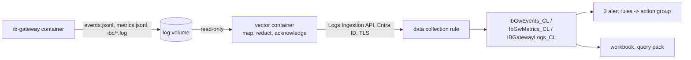

# Azure Log Analytics pack

Contents: [Overview](#overview) · [Set-up](#set-up) · [One-click VM](#one-click-vm-optional) ·
[What is shipped](#what-is-and-is-not-shipped) · [Alerts](#alerts) · [Queries](#queries) ·
[Latency](#latency) · [Cost](#cost) · [Limits](#limits) · [Security](#security) ·
[Troubleshooting](#troubleshooting) · [Other destinations](#other-destinations) · [Tests](#tests)

## Overview

Ship the gateway's events, metrics and (opt-in, redacted) raw logs to **your own** Azure Log
Analytics workspace, with three alert rules, a workbook and a query pack. One
`az deployment group create`, one compose profile. Nothing here gives anyone but you access to
anything.



## Set-up

You need the Azure CLI (`az login` done), a resource group, and Docker on the gateway host.
Commands run from the repository root.

### 1. Deploy

Copy `azure/bicep/main.bicepparam`, fill in the placeholders (alert e-mail, maintenance window;
leave `ingestPrincipalId` empty for now if you do not have the identity yet), then:

```bash
az deployment group create -g <resource-group> -n main \
  -f azure/bicep/main.bicep -p <your-copy>.bicepparam
az deployment group show -g <resource-group> -n main --query properties.outputs
```

You should see `"provisioningState": "Succeeded"` and the outputs `logsIngestionEndpoint`
(`https://...ingest.monitor.azure.com`), `dcrImmutableId` (`dcr-` + 32 hex), `tenantId` and
`dcrResourceId`. A malformed `maintenanceWindowUtc` stops the deployment with a message that
names it.

### 2. Choose the identity that ships

**A. Gateway on an Azure VM: managed identity (no secret at all).** Give the VM a
system-assigned identity and pass its object id as `ingestPrincipalId` (redeploy step 1):

```bash
az vm identity assign -g <vm-resource-group> -n <vm-name> --query systemAssignedIdentity -o tsv
```

**B. Windows (Docker Desktop) or on-premises: Entra application with a certificate.**

```bash
# App + service principal + self-signed certificate; no role is assigned by this command.
az ad sp create-for-rbac --name ibgw-log-shipper --create-cert --years 1
#   note "appId", "tenant" and "fileWithCertAndPrivateKey" (a .pem file in your home directory)
az ad sp show --id <appId> --query id -o tsv      # object id -> ingestPrincipalId, redeploy step 1
# PEM -> passwordless PKCS#12 for Vector (Git for Windows ships openssl), then delete the PEM.
openssl pkcs12 -export -in <fileWithCertAndPrivateKey> -out compose/secrets/azure-client-cert.pfx -passout pass:
```

You should see, after the redeployment, one role assignment on the data collection rule:
`az role assignment list --scope <dcrResourceId> -o table` shows *Monitoring Metrics Publisher*
for your identity and nothing else. The private key lives only in
`compose/secrets/azure-client-cert.pfx` (git-ignored; on Linux make it readable by uid 1000 only).
A client secret would also work with Vector, but it is a password in a file that expires
silently; this pack does not ship a profile for it.

**The certificate expires** (after one year with the command above). From that day the shipper
cannot authenticate, nothing arrives and rule C fires; what the gateway rotates out of its log
files before you renew, and anything older than 36 hours by then, is lost. Put the date in a
calendar and renew before it:
`az ad sp credential reset --id <appId> --create-cert --years 1 --append`, convert the new PEM
as above, replace the `.pfx` and restart the shipper (`docker compose ... restart vector-cert`).

### 3. Put the values into `compose/.env`

```ini
DCR_LOGS_ENDPOINT=<output logsIngestionEndpoint>
DCR_IMMUTABLE_ID=<output dcrImmutableId>
# certificate identity only:
AZURE_TENANT_ID=<output tenantId>
AZURE_CLIENT_ID=<appId>
# labels on every row: letters, digits, dot, underscore, hyphen, at most 64 characters
IBGW_INSTANCE=paper-1
HOST_LABEL=desk-host-1
```

**Every gateway needs its own `IBGW_INSTANCE`.** The alert rules tell gateways apart by
`Instance` (rule B) and by `Instance` and `Host` (rules A and C); two gateways with the same
labels would hide each other's silence. The shipper therefore refuses to start (exit code 78)
with the default label `default` and no `HOST_LABEL`, and refuses a label that looks like an
IBKR account id.

You should see the values back in
`docker compose -f compose/docker-compose.example.yml -f compose/docker-compose.azure.yml --profile azure config`.
Do not commit `compose/.env`.

### 4. Start the shipper

```bash
# managed identity (Azure VM)            # certificate (Windows / on-premises): --profile azure-cert
docker compose -f compose/docker-compose.example.yml -f compose/docker-compose.azure.yml --profile azure up -d
docker compose -f compose/docker-compose.example.yml -f compose/docker-compose.azure.yml --profile azure logs vector
```

Start exactly one of the two profiles. You should see JSON lines only; within about a minute a
line with `"name":"component_sent_events_total"` and `"component_id":"azure_metrics"` whose
value is above 0, and no line with `"level":"ERROR"`. A wrong setting stops the container at
once with one line that names the variable (exit code 78).

### 5. Run the first query

Portal: the workspace, **Logs**. Or:

```bash
az monitor log-analytics query \
  -w "$(az monitor log-analytics workspace show -g <resource-group> -n ibgw-logs --query customerId -o tsv)" \
  --analytics-query "IbGwMetrics_CL | summarize Rows = count(), Last = max(TimeGenerated) by Instance, Host, Phase"
```

You should see one row per instance, host and phase, with `Last` a few seconds to a few minutes
old. Brand-new tables, rules and role assignments take minutes to become effective (Microsoft's
tutorial allows up to 30); the shipper keeps retrying and reads the lines again from the
gateway's log files. Then open the workbook **IB Gateway** in the resource group.

## One-click VM (optional)

`azure/bicep/vm.bicep` creates one Ubuntu 26.04 LTS VM that runs the gateway and the shipper:
no public IP, every inbound connection denied, a NAT gateway for outbound traffic, a Key Vault,
a daily patch window that never reboots on its own. It takes **no IBKR credential as a
parameter**.

```bash
az deployment group create -g <resource-group> -n vm \
  -f azure/bicep/vm.bicep -p <your-copy-of-vm>.bicepparam
# then, once (the files hold one line; a byte-order mark and line ends are ignored):
az keyvault secret set --vault-name <output keyVaultName> --name ib-username --file ./ib-username --encoding utf-8
az keyvault secret set --vault-name <output keyVaultName> --name ib-password --file ./ib-password --encoding utf-8
```

To set the secrets you need a data role on the vault and network access to it: pass your own
object id as `vaultOperatorPrincipalId` (you then receive *Key Vault Secrets Officer*; default:
nobody does) and your workstation's public address in `keyVaultAllowedCidrs`.

You should see, within about ten minutes of setting the second secret, rows of the VM in
`IbGwMetrics_CL` and the gateway asking for its second factor (alert rule A reports it after
five minutes; nothing approves it for you).

**Getting in.** With the defaults nothing can connect to the VM, and the only way in is
`az vm run-command` (the Azure agent on the VM, authorised by your Azure role):

```bash
az vm run-command invoke -g <resource-group> -n <output vmName> --command-id RunShellScript \
  --scripts "systemctl is-active ibgw-bootstrap ibgw-stack; /usr/local/sbin/ibgw-compose.sh ps"
```

SSH works only when you pass `adminSourceCidr`: the range of a jump host or VPN in a peered
network, or the range of an `AzureBastionSubnet` that you add yourself (this template does not
create a Bastion). The serial console needs an account with a password; the template creates
none, so the serial console does not work either.

**Changing the VM later.** The image digests, the pack commit, the labels, the raw-log switch
and the gateway settings live in the VM's *userData*, which can change in place; the
first-boot script (*customData*) is fixed, because Azure refuses to change it on an existing
VM. To change something:

```bash
# 1. redeploy with the new values (updates the userData; the VM keeps running)
az deployment group create -g <resource-group> -n vm -f azure/bicep/vm.bicep -p <your-copy-of-vm>.bicepparam
# 2. apply on the VM
az vm run-command invoke -g <resource-group> -n <output vmName> --command-id RunShellScript \
  --scripts "/usr/local/sbin/apply-config.sh"
```

You should see `apply-config: applied. The gateway container was not touched.` for a change
that concerns only the shipper. A change that would re-create the gateway container (a new
gateway image, a gateway setting) is **not** applied: the script says that IB Gateway would
restart and need a new login with second-factor approval, changes nothing and exits with
code 3. Run it again with `--restart-gateway` when a human is ready to approve; even then it
refuses (code 4) while the gateway's phase is `2fa-pending`.

**What restarts the gateway.** Nothing does on its own: patches never reboot
(`patchRebootSetting`), the Docker packages are excluded from the patch window, the Docker
daemon keeps containers running across its own restart (`live-restore`), and the stack's
systemd unit only *wants* the Docker unit instead of requiring it. The last two are by
configuration and by reading the systemd and Docker documentation; no VM has confirmed them yet.
The first-boot bootstrap is a systemd unit that retries with a growing delay until it has
succeeded once (`systemctl status ibgw-bootstrap`).

**Deleting and deploying again.** The Key Vault has purge protection: after you delete it (or
its resource group), its name stays taken for 90 days and a new deployment into a resource
group of the same name fails. Recover the vault first (`az keyvault recover --name <name>`),
or deploy with another `namePrefix` or into another resource group.

The gateway API stays on the VM's loopback; serving a strategy host means setting `PRIVATE_IP`
and adding an inbound rule yourself. Encryption at host needs the subscription feature
`Microsoft.Compute/EncryptionAtHost` (or `encryptionAtHost=false`).

## What is and is not shipped

| Shipped | Table | Notes |
|---|---|---|
| Structured events (`events/events.jsonl`) | `IbGwEvents_CL` | columns `TimeGenerated`, `Instance`, `Host`, `BootId`, `Seq`, `Src`, `Level`, `Event`, `Msg`, `Props`; `Props` is the event's `data` object plus any key the gateway adds later; malformed lines dropped and counted |
| Metric samples every 30 s (`metrics/metrics.jsonl`) | `IbGwMetrics_CL` | `Phase` and the measured values; a value that was not measured is empty, never 0 |
| IBC and launcher text (`ibc/*.log`, `jts/*.log`), **only after you opt in** | `IBGatewayLogs_CL` | redacted on the host, at most 32,768 bytes per line; a line longer than 256 KiB is not shipped |

**Not shipped, because it cannot be read:** IBKR encrypts the Gateway's own log files on disk.
What leaves the host is the structured events, the metrics and the IBC/launcher text after
redaction. Never shipped: the password, the full account id, anything from the settings volume.
Not shipped yet: IB API connectivity codes (1100 and friends); only an API client sees them and
no component writes them to the log volume today.

**History older than 36 hours is not back-filled.** Azure stamps a row that is more than two
days old with its arrival time, which would put old events at the wrong place; the shipper
drops such lines and says so in its own log (`dropped an event older than 36 hours`).

Redaction happens in Vector on your host, before the network. In every stream an account id
(`DU`, `DF`, `U` or `F` followed by 5 to 9 digits, in any case, also next to an underscore,
glued to a lower-case word or after an escaped line break) becomes `[ACCT:…567]`. Raw logs can
contain your IBKR user name, so they stay on the host unless you choose one of:

- `IBGW_REDACT_USERNAME_FILE=/run/secrets/ib-username` in `compose/.env`: raw lines are
  shipped and the user name, in any case, becomes `[USER]`. The file is read as the gateway
  reads it (a UTF-8 byte-order mark and line ends are ignored); a file that is empty, UTF-16
  or not one word of printable ASCII stops the shipper instead of silently redacting nothing;
- `SHIP_RAW_LOGS=yes`: raw lines are shipped with account ids redacted and the user name
  **left in place** (the shipper logs a warning at start).

Tightening the choice later (from `SHIP_RAW_LOGS=yes` to the file, or to nothing) applies to
every line that was not delivered yet: rows wait in memory only and are mapped again under the
setting in force after a restart.

## Alerts

Three log search rules (billed per rule, hence consolidated), resolving by themselves; the
queries are the documented files in `azure/kql/`.

| Rule | Every | Split by | Fires when (`Condition`) |
|---|---|---|---|
| A human needed (`alert-human-needed.kql`) | 5 min | `Instance`, `Host`, `Condition` | `twofa_pending`: the first second-factor prompt without a completed login after it is older than 5 min; `needs_human`: the gateway asked for a human; `not_logged_in`: not logged in for more than 10 min outside the maintenance window |
| B health (`alert-health.kql`) | 5 min | `Instance`, `Condition` | `memory_high` (above 85 % of the container limit for 10 min; never without a limit), `restart_loop` (3 container starts in 30 min), `oom_kill`, `disk_low` (not followed by `disk_ok`), `login_stalled` (not followed by `login_resumed`), `needs_human`, `unknown_window`; silent in the maintenance window |
| C dead man (`alert-dead-man.kql`) | 15 min | `Instance`, `Host`, `Condition` | `no_metrics`: no metrics row arrived for 10 min (gateway, shipper, host or network down); `stale_samples`: rows arrive but the newest sample is more than 10 min old |

Rule A is built on events, not on "the phase has been `2fa-pending` for 5 minutes": an
unanswered prompt times out after about three minutes, the phase flips to `login` and back with
a new prompt, for hours, and no single phase ever lasts 5 minutes. Rule C's worst case from the
last row to the notification is 25 to 30 minutes (10 minutes of silence, up to 15 until the
next evaluation, then the alert pipeline).

`maintenanceWindowUtc` (for example `03:40-05:00`) covers the daily restart; it is in UTC and
`AUTO_RESTART_TIME` is exchange-local, so make it wide enough for summer and winter time.
Alerts tell a human; nothing here restarts the gateway or touches the second factor.

## Queries

The deployment creates the query pack `<namePrefix>-queries` (**Logs**, **Queries**) with every
file of `azure/kql/`: the three alert queries (to see what a rule sees) and
`session-timeline.kql` (every stretch of time per phase), `twofa-approval-time.kql` (weekly
percentiles from the first second-factor request to the completed login), `monthly-uptime.kql`
(share of the month in `logged-in`, IBKR reset windows left out, missing data counted against
uptime), `sequence-gaps.kql` (`Seq` gaps per `BootId` = events that never arrived).

`azure/kql/scenarios/` holds timelines in the gateway's real event shape (the second-factor
flip for 30 minutes, the same ending in a login, a fresh prompt, a disk that filled and
recovered, ...) with the rows each alert query must return for them. Paste a scenario followed
by its query into **Logs** to see the rule's verdict on it.

## Latency

Rows are queryable seconds to a few minutes after the gateway wrote them (Vector sends a batch
after at most 5 seconds; Azure's ingestion adds the rest). Alert rules evaluate every 5 or 15
minutes. That is the right tool for "within a quarter of an hour" and for history; **for a
seconds-scale second-factor page use the sidecar notifier**, not these rules.

## Cost

List prices in USD from the Azure Retail Prices API on 2026-11-12 (East US where a price is
regional); your region, currency and agreement differ, so check
<https://azure.microsoft.com/pricing/details/monitor/>.

| Item | Price | This pack, one gateway |
|---|---|---|
| Analytics ingestion (events, metrics) | $2.30 per GB (first 5 GB per billing account and month free) | metrics 2,880 rows/day × ~0.45 KB ≈ 39 MB/month; events ~300/day × ~0.35 KB ≈ 3 MB/month; 0.042 GB × $2.30 ≈ **$0.10** |
| Raw lines, Auxiliary plan (default) | $0.05 per GB | assuming 5,000 lines/day × ~0.25 KB ≈ 37 MB/month ≈ **$0.002**; Basic $0.50/GB ≈ $0.02; Analytics ≈ $0.09 |
| Log search alert rules | $1.50 per rule and month at 5 min, $0.50 at 15 min | 2 × $1.50 + $0.50 = **$3.50** |
| Per time series of a split rule | $0.15 (5 min) / $0.05 (15 min) per month | check the pricing page for how series are counted |
| Notifications | e-mail: first 1,000 per month free; SMS and voice priced per country | check the pricing page |
| Queries on Basic/Auxiliary tables | $0.005 per GB scanned | negligible at this volume |
| Optional VM template: NAT gateway | $0.045 per hour plus $0.045 per GB processed, and $0.005 per hour for its public IP | 730 h × $0.050 ≈ **$36.50** plus traffic |

So about **USD 4 per month** for the pack itself, almost all of it the three alert rules. Row
sizes are estimates from the JSON text; Azure bills its own stored size. Workbooks and query
packs are free. The optional VM template costs far more than the logging: the NAT gateway alone
is about USD 36 per month, and the VM, its disk and the Key Vault come on top (see their
pricing pages). Retention beyond the included days is extra.

## Limits

- One API call is at most 1 MB and one value at most 64 KB (Azure Monitor service limits); the
  shipper batches below that and cuts raw lines at 32,768 bytes (`Truncated` = true).
- A schema change takes minutes to propagate and a key the stream does not declare is dropped
  silently: add a column to `tables.bicep` and `dcr.bicep` and deploy **before** Vector emits it.
- An Auxiliary table can never change its plan, cannot feed an alert rule and is slower to query.
- Delivery is at least once. The shipper keeps rows in memory and remembers a position in a log
  file only after Azure accepted the rows up to it; after a crash, a restart or an outage it
  reads the undelivered lines again, so a row can arrive twice, never zero times, as long as
  the line is still in the gateway's log files. What the gateway rotates away during a long
  outage is lost, and `sequence-gaps.kql` shows it. While Azure is unreachable, events and
  metrics wait; raw lines are dropped instead, so they can never hold back the rows the alerts
  depend on.
- The dead-man rule knows a gateway for two days after its last row.
- The alert rules run with the access of whoever deployed them last.
- An account id written without its prefix, or directly after an upper-case letter or a digit
  (`XDU1234567`), is not recognised; neither is one followed by letters.

## Security

- Your tenant, your workspace: no Azure Lighthouse, no foreign principal, no RocketEdge
  identifier.
- Role assignments of `main.bicep`: one, *Monitoring Metrics Publisher* on the data collection
  rule, to the identity you named; it can send rows and cannot read them.
- Role assignments of `vm.bicep`: for the VM's own managed identity, *Key Vault Secrets User*
  on the vault and *Monitoring Metrics Publisher* on the data collection rule; and only when you
  pass `vaultOperatorPrincipalId`, *Key Vault Secrets Officer* on the vault for that principal.
- The shipper has no published port and no `docker.sock`; it runs as uid 1000 on a read-only
  root filesystem without capabilities, capped at half a CPU core and 512 MB, and mounts the
  log volume read-only.
- No credential is in this repository, in a template parameter or in a log line. The shipper's
  own log never shows a line of the gateway: Vector's file-source messages are switched off for
  that reason (they would print the start of a discarded over-long line), and its counters say
  the same on stdout.
- The gateway never depends on the shipper: if the shipper fails, the gateway runs on and rule
  C fires.
- The second factor is never automated, and nothing here places, changes or cancels an order.

## Troubleshooting

| Symptom (in `docker compose ... logs vector`) | Cause and fix |
|---|---|
| Container exits with code 78 and one `"level":"error"` line | the named variable in `compose/.env` is missing or malformed; `IBGW_INSTANCE=default` without `HOST_LABEL` is refused |
| `Azure returned 403 Forbidden` | the identity lacks *Monitoring Metrics Publisher* on the rule, or the assignment is still propagating (the shipper keeps retrying) |
| `Azure returned 404 Not Found` | wrong `DCR_LOGS_ENDPOINT` or `DCR_IMMUTABLE_ID`, or the rule is minutes old |
| `Failed response ... 169.254.169.254` then `Request timed out` | profile `azure` on a host without a managed identity: use `azure-cert` (the shipper keeps retrying until then) |
| It worked for a year, then nothing arrives | the certificate expired; see [step 2](#2-choose-the-identity-that-ships) |
| Rows arrive but a column stays empty | the stream does not declare the key yet (see Limits) |
| `IBGatewayLogs_CL` is empty | raw logs are opt-in; see [What is shipped](#what-is-and-is-not-shipped) |
| No row at all, no error | look at the counter lines: `"name":"open_files"` must be above 0 for `events_file` and `metrics_file`; if it is 0, the gateway image does not write `events/events.jsonl` / `metrics/metrics.jsonl` (log contract v2) |
| `component_errors_total` with `"error_code":"reading_line_from_file"` | a line longer than the limit (100 KiB for events and metrics, 256 KiB for raw text) was skipped; its content is deliberately not printed |
| `dropped an event older than 36 hours` | history is not back-filled (see [What is shipped](#what-is-and-is-not-shipped)) |

## Other destinations

Vector is not tied to Azure: the same sources and mappings (`azure/vector/vector.yaml`) can feed
its `loki`, `datadog_logs` or `aws_s3` sinks instead; replace the sink file and keep the rest.

## Tests

`azure/tests/run.sh` runs everything offline (Docker and the Bicep CLI; no Azure login): VRL
unit tests, the real container on lines of a real gateway run, the schema-drift check between
Vector's rows and the compiled Bicep, static analysis of every query and scenario, the compiled
templates' roles and network rules, the VM's host scripts with fake `curl`, `docker` and `git`,
compose, shellcheck.

Not part of it, and therefore unproven until you deploy: real ingestion and authentication, the
role assignments taking effect, the alert rules firing, the workbook and the query pack in the
portal, and everything about the VM (first boot, `apply-config.sh` on a real VM, the systemd and
Docker restart behaviour). The alert queries are type-checked against the deployed schema but
**not executed** by default: `KUSTO_EMULATOR_EULA=accept azure/tests/run.sh kql-run` runs the
scenarios in Microsoft's Kusto emulator, which requires accepting its licence terms first.

Interactive Brokers, IBKR, IB Gateway and Trader Workstation are trademarks of Interactive
Brokers LLC. This project is not affiliated with, endorsed by or sponsored by Interactive Brokers.
