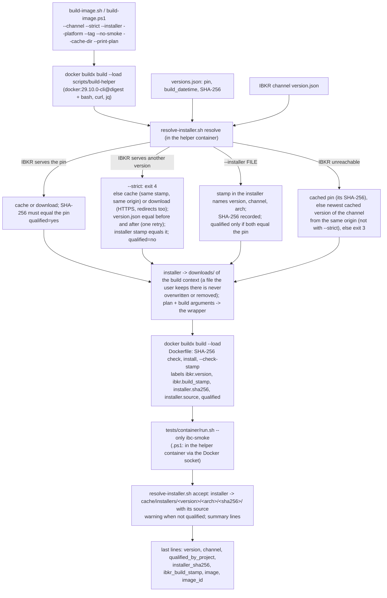
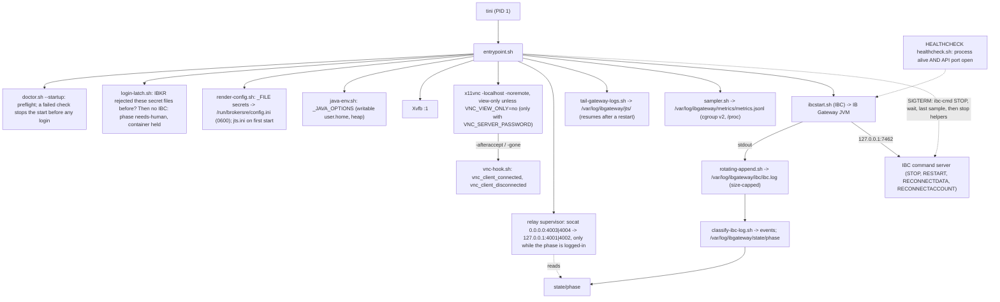
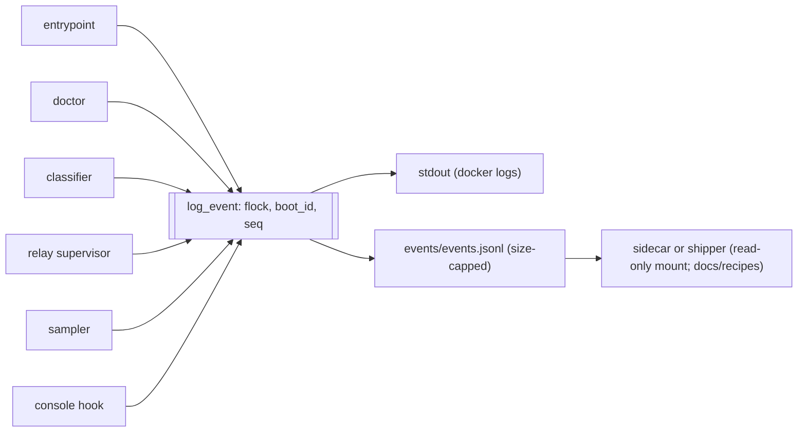

# Architecture

## Build pipeline

```mermaid
flowchart LR
  vj["versions.json\n(base digest, Gateway versions + SHA-256, IBC tag + SHA-256)"] --> env["scripts/bake-env.sh"]
  env --> bake["docker buildx bake (docker-bake.hcl)"]
  bake --> df["Dockerfile stage 1: fetch-installer.sh verifies SHA-256, installs Gateway, checks its build stamp (--check-stamp); downloads IBC from RocketEdge/ibc, verifies SHA-256"]
  df --> rt["Dockerfile stage 2: ubuntu:26.04@digest + tini, Xvfb, socat, x11vnc, Java libs; uid 1000; rootfs/"]
  vj --> plan["plan: channel list (publish-channels.sh), no tag in both channels (check-bake-tags.sh)"]
  rt --> push["multi-arch build, no cache, pushed BY DIGEST (no tag) to the PRIVATE package (ADR 0018)"]
  push --> scan["Trivy v0.76.2 gate on linux/amd64 and linux/arm64 of that digest; each report checked for its platform"]
  scan --> sbom["one SBOM per platform, attested to that platform's manifest"]
  sbom --> sign["cosign sign + VEX attestation + build provenance on the index"]
  sign --> tags["scripts/promote-tags.sh: tags -> the scanned digest"]
  tags --> rel["git tag v<version>-<channel>, release with digests-<channel>.json, two SBOMs, VEX"]
  daily["rebuild.yml (daily): scan the published images"] -. "fixable CRITICAL/HIGH -> issue, rebuild request" .-> plan
  ibkr["IBKR version.json (hourly; installers hashed daily and at the first sight of a version)"] -. "detect-releases.yml -> PR" .-> vj
  ibc["RocketEdge/ibc releases (daily)"] -. "detect-ibc-release.yml -> PR" .-> vj
```

## Building the image yourself (and in CI)

`scripts/build-image.sh` and `scripts/build-image.ps1` build one platform of the image on any
host with Docker (ADR 0018). The decision, the download, the verification and the cache are
one bash script, `scripts/resolve-installer.sh`, run in a helper container; the wrappers only
pass arguments, run the build and the smoke test with the host's Docker, and print the
result. CI's `build-test` job and the sidecar's end-to-end job build with `build-image.sh` and
test the result as `brokersre-ib-gateway:stable`: no job started by a push or a pull request
pulls RocketEdge's image, which is private (ADR 0018). Only `publish.yml`, the daily scan of
`rebuild.yml` and `qualify-paper.yml` read the package, each after a registry login with the
workflow's token.

## Runtime process tree

## Events: one writer function, two destinations

Every component emits events through `log_event` (`log.sh`). Under a file lock it gives the
event the next sequence number of this container start and writes the identical line to stdout
and to `events/events.jsonl`.

## Contract with a sidecar

A sidecar shares the network namespace (`network_mode: "service:ib-gateway"`) and mounts
`/var/log/ibgateway` read-only. It reads `state/phase`, `events/events.jsonl` and
`metrics/metrics.jsonl`, and can connect to the Gateway on `127.0.0.1:4001|4002`. The raw logs
(`ibc/ibc.log`, `jts/*.log`) may contain the username and must not leave the host unredacted.
A sidecar never mounts the settings volume (which holds the auto-restart session token).
The IBC command server on `127.0.0.1:7462` is reachable from the shared namespace; a sidecar
that only observes never sends it anything. Specified in [log-contract.md](log-contract.md).
