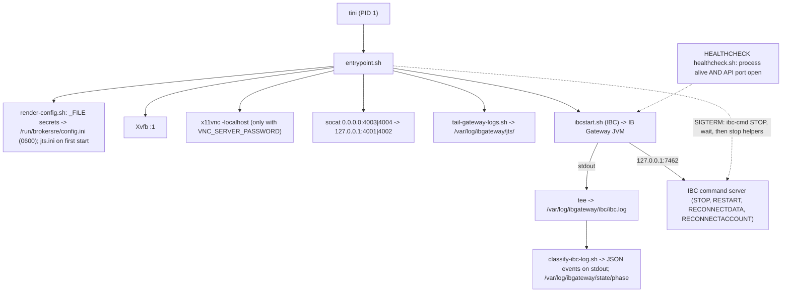

# Architecture

## Build pipeline

```mermaid
flowchart LR
  vj["versions.json\n(base digest, Gateway versions + SHA-256, IBC tag + SHA-256)"] --> env["scripts/bake-env.sh"]
  env --> bake["docker buildx bake (docker-bake.hcl)"]
  bake --> df["Dockerfile stage 1: fetch-installer.sh verifies SHA-256, installs Gateway; downloads IBC from RocketEdge/ibc, verifies SHA-256"]
  df --> rt["Dockerfile stage 2: ubuntu:26.04@digest + tini, Xvfb, socat, x11vnc, Java libs; uid 1000; rootfs/"]
  rt --> scan["Trivy (amd64, before push)"]
  scan --> push["multi-arch push -> ghcr.io/rocketedge/brokersre-ib-gateway"]
  push --> sign["cosign sign + CycloneDX attestation + build provenance"]
  sign --> rel["git tag v<version>-<channel>, GitHub release with digests-<channel>.json"]
  ibkr["IBKR version.json (daily)"] -. "detect-releases.yml -> PR" .-> vj
  ibc["RocketEdge/ibc releases (daily)"] -. "detect-ibc-release.yml -> PR" .-> vj
```

## Runtime process tree

## Contract with a sidecar (the BrokerSRE agent)

The sidecar shares the network namespace (`network_mode: "service:ib-gateway"`), connects to the
Gateway on `127.0.0.1:4001|4002`, drives IBC through `127.0.0.1:7462`, mounts
`/var/log/ibgateway` read-only and reads `state/phase`, `ibc/ibc.log` and `jts/*.log`. It never
mounts the settings volume (which holds the auto-restart session token). Specified in
[log-contract.md](log-contract.md).
