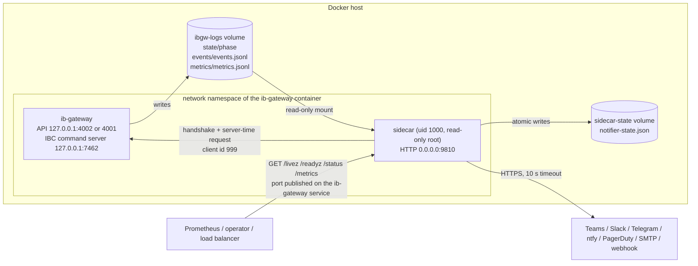
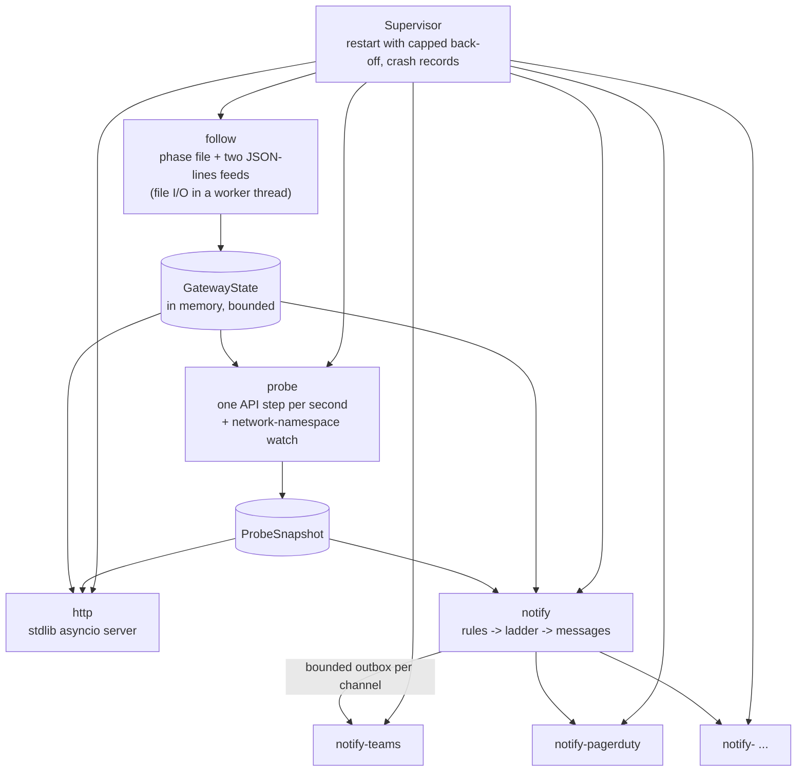
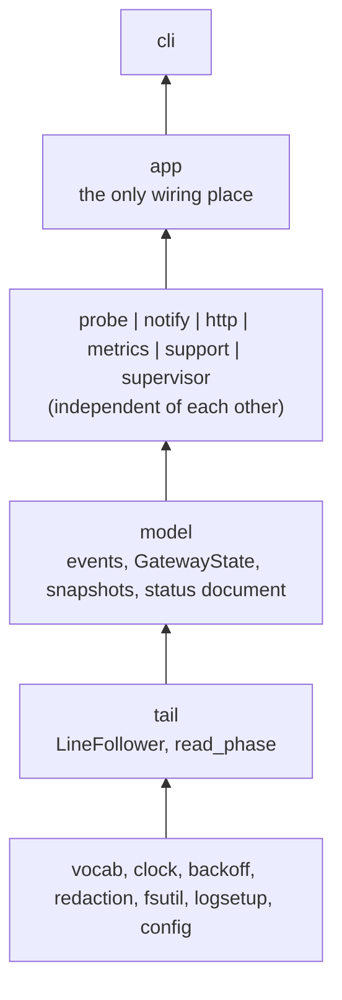
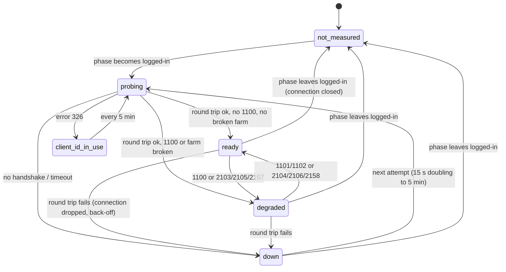
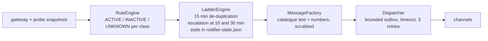

# Sidecar architecture

The sidecar (`sidecar/`, image `ghcr.io/rocketedge/brokersre-ib-gateway-sidecar`) is an
optional companion of the gateway container. It observes and reports; it never acts on the
gateway. User documentation: [sidecar/README.md](../sidecar/README.md). Decision record:
[ADR 0010](adr/0010-sidecar-for-probe-status-and-alerts.md).

## Where it sits

The sidecar never connects to the IBC command server and never mounts the gateway's
settings volume or the Docker socket.

## Tasks and isolation

Every subsystem is an asyncio task under one supervisor. A task that raises or returns is
recorded (exception class, time, restart count) and started again after a capped
exponential back-off (1 s doubling to 60 s). The records are in `/status` (`tasks`) and in
`ibgw_sidecar_task_restarts_total`.

What one failing part can do to the others:

| Failure | Effect | What still works |
|---|---|---|
| A webhook never answers | Its own `notify-<channel>` task waits out a 10 s timeout, retries three times, counts a failure | Every other channel, the probe, the endpoints |
| The log volume hangs | `follow` times out after 10 s and is restarted; `gateway_silent` fires | The probe, the endpoints, delivery |
| The gateway API hangs | `probe` is bounded by the handshake and round-trip timeouts; status becomes `down` | Everything else |
| A slow or malformed HTTP client | One of 32 connection slots for at most 5 s | Other clients, everything else |
| The state directory is read-only | The notifier keeps its state in memory and reports that in `/status` | Notifications (de-duplication does not survive a restart) |
| The sidecar is down | Nothing is reported; the Docker health check and the missing heartbeat show it | The gateway: it does not depend on the sidecar |

## Layers

Import rules, enforced by `sidecar/tests/test_architecture.py` (a module imports its own
unit and lower layers only):

`ib_async` is imported by `probe/adapter.py` only, and that module by `app.py` only.
Everything else talks to the gateway through the `IbClient` protocol (connect, ask the
server time, disconnect, receive notice codes), so it is tested against a scriptable fake
gateway, and the adapter itself against an in-process server that speaks the IB API wire
protocol and records what the client sends.

## Following the gateway

`LineFollower` re-opens the file on every poll and identifies it by device, inode and its
first bytes. It tolerates the file missing at start, a partial last line, rotation by
rename (the predecessor `<name>.1` is drained first), truncation in place, bytes that are
not UTF-8 and oversized lines. Parsing keeps only vocabulary fields and numbers: the `msg`
of an event and unknown keys are dropped at this boundary, because the gateway may put the
IBKR username there. What the model never holds, no output can leak.

## The probe

The adapter uses ib_async's low-level `Client`, not its `IB` class: in ib_async 2.1.0
`IB.connectAsync` always requests positions, and `IB` answers notice 1102 with an
account-summary subscription that is never cancelled. `Client` performs the handshake and
then sends only what the adapter asks for: the server-time request.

## Notifications

An `UNKNOWN` verdict (a value not measured, a duration not yet elapsed, an IBKR reset
window) changes nothing: it neither raises nor resolves an alert. That is also why a
restart of the sidecar cannot send a false "resolved".

## When the gateway container restarts

A container that shares another container's network namespace keeps the old namespace
when that container restarts. The sidecar notices (it had seen the gateway's listening
sockets, the gateway is alive according to its log volume, and the sockets stay gone for
60 s) and exits with code 75. Its restart policy starts it again, inside the gateway's new
namespace. The gateway is not touched. `EXIT_WHEN_ORPHANED=no` turns this off.

Interactive Brokers, IBKR, IB Gateway and Trader Workstation are trademarks of Interactive Brokers LLC. This project is not affiliated with, endorsed by or sponsored by Interactive Brokers.
