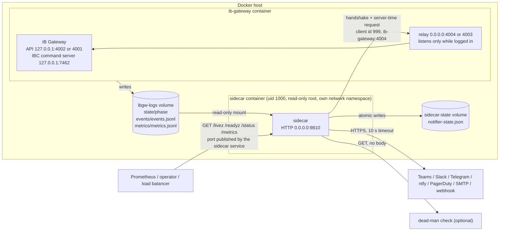
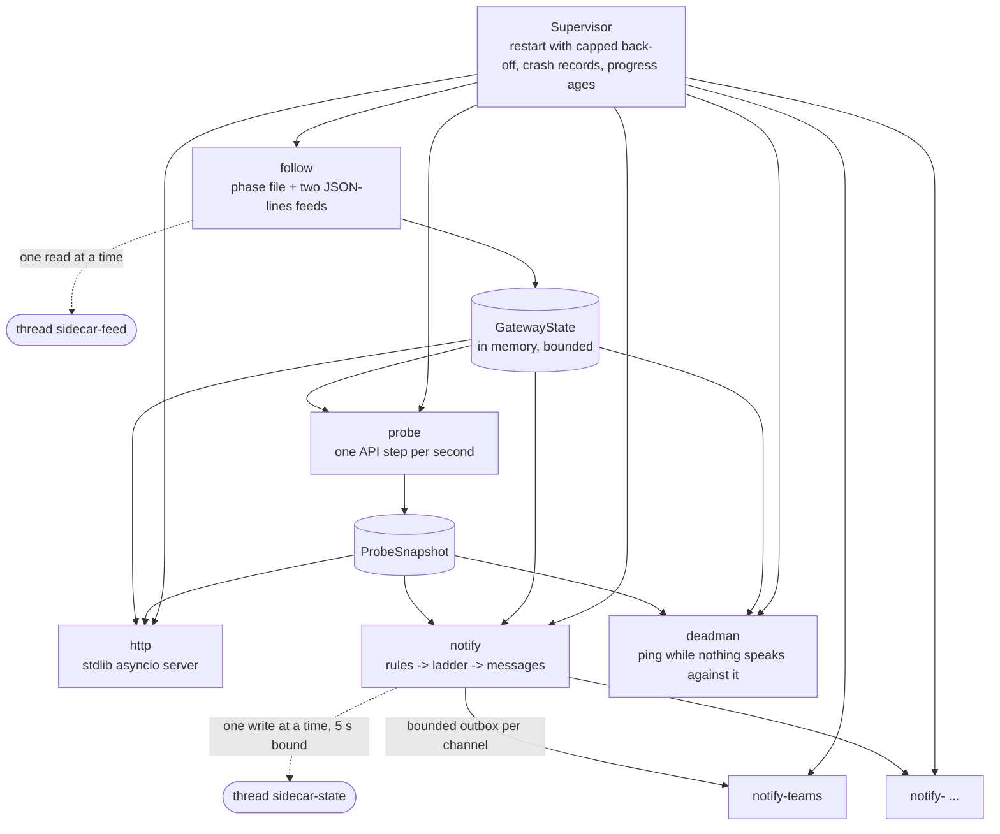
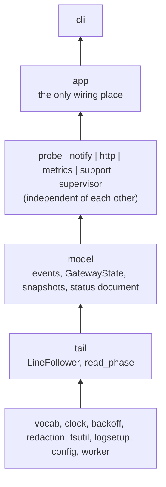
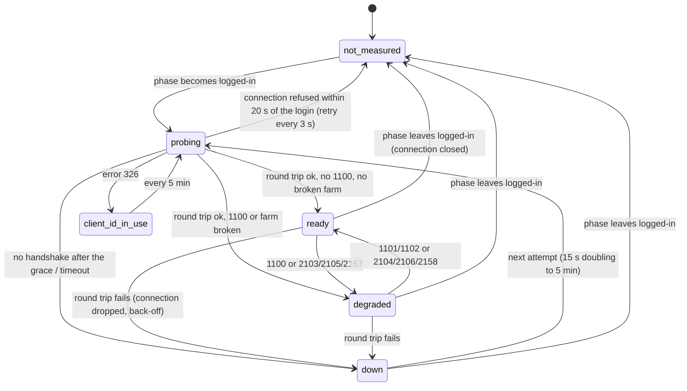
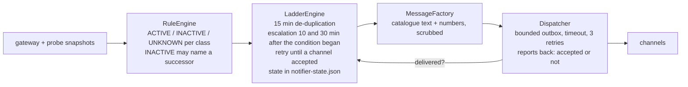

# Sidecar architecture

The sidecar (`sidecar/`, image `ghcr.io/rocketedge/brokersre-ib-gateway-sidecar`) is an
optional companion of the gateway container. It observes and reports; it never acts on the
gateway. User documentation: [sidecar/README.md](../sidecar/README.md). Decision record:
[ADR 0010](adr/0010-sidecar-for-probe-status-and-alerts.md).

## Where it sits

By default the sidecar is an ordinary container with its own network namespace. It shares
exactly one thing with the gateway: the log volume, mounted read-only.

The sidecar never connects to the IBC command server and never mounts the gateway's
settings volume or the Docker socket. From its own network namespace it cannot even reach
the Gateway's loopback ports.

The relay is the path every API client outside the gateway container uses, so a probe
through it measures what a strategy would get. It listens only while the gateway is logged
in and opens a moment after the phase file says so; the probe treats a refused connection
in the first 20 seconds after a login as "not open yet" (`not_measured`, retried every
3 seconds) and as `down` afterwards. Outside phase `logged-in` the probe sends nothing.

### The optional shared network namespace

With `GATEWAY_HOST` set to a loopback address and `network_mode: "service:ib-gateway"` the
sidecar runs inside the gateway's network namespace and probes the Gateway's own API port.
This mode is kept for operators who want that measurement; it is not the default because of
what happens when the gateway container goes away (see
[When the gateway stops or restarts](#when-the-gateway-stops-or-restarts)).

## Tasks and isolation

Every subsystem is an asyncio task under one supervisor. A task that raises or returns is
recorded (exception class, time, restart count) and started again after a capped
exponential back-off (1 s doubling to 60 s). Every periodic task reports each completed
step; a task that reports nothing for about a minute (plus the longest wait one step may
take) is stalled. The records are in `/status` (`tasks`), in
`ibgw_sidecar_task_restarts_total`, `ibgw_sidecar_task_progress_age_seconds` and
`ibgw_sidecar_task_stalled`, and a stalled task makes `/livez` answer 503.

Blocking file I/O never runs on the event loop and never on a shared thread pool. The feed
and the state file each have one dedicated daemon thread (`SerialWorker`) that runs one call
at a time:

- **Feed.** At most one read of the volume is ever in flight. A read that does not return
  within 10 seconds is not abandoned and started again (threads would pile up behind the
  same stuck call, and the file offsets a late read advanced would be lost): the task keeps
  waiting for that read, also across a restart of the task, and the phase is unknown
  meanwhile.
- **State file.** One write at a time, awaited for at most 5 seconds. A write that hangs or
  fails leaves the state in memory (`/status` says so) and is tried again after 30 seconds
  with whatever the state is then.

What one failing part can do to the others:

| Failure | Effect | What still works |
|---|---|---|
| A webhook never answers | Its own `notify-<channel>` task waits out a 10 s timeout, retries three times, counts a failure; the alert stays "not notified" and is sent again with a capped back-off | Every other channel, the probe, the endpoints |
| The log volume hangs | `follow` waits for the one stuck read; the phase becomes unknown, `volume_missing` fires after 5 minutes, `/livez` fails after about a minute, the dead-man ping stops | The probe task, the endpoints, delivery |
| The log volume is not mounted | The phase is unknown; `volume_missing` after 5 minutes; no heartbeat; the dead-man ping is withheld | The endpoints (which say what is not measured), delivery |
| The gateway API hangs | `probe` is bounded by the handshake and round-trip timeouts; status becomes `down` | Everything else |
| A slow or malformed HTTP client | One of 32 connection slots for at most 5 s | Other clients, everything else |
| The state directory is read-only, or a write hangs | The notifier keeps its state in memory and reports that in `/status` | Notifications (de-duplication does not survive a restart) |
| The gateway container stops, exits or is killed | The sidecar keeps running and announces it (see below) | The sidecar entirely |
| The sidecar or its host dies | Nothing is sent by the sidecar. The dead-man check alarms when the pings stop; the Docker health check shows a broken sidecar on a live host | The gateway: it does not depend on the sidecar |

## Layers

Import rules, enforced by `sidecar/tests/test_architecture.py` (a module imports its own
unit and lower layers only):

`ib_async` is imported by `probe/adapter.py` only, and that module by `app.py` only.
Everything else talks to the gateway through the `IbClient` protocol (connect, ask the
server time, disconnect, receive notice codes), so it is tested against a scriptable fake
gateway, and the adapter itself against an in-process server that speaks the IB API wire
protocol and records what the client sends. After the handshake the adapter drops the
account list the Gateway sends unasked; the probe keeps no account id.

## Following the gateway

`LineFollower` re-opens the file on every poll and identifies it by device, inode and its
first bytes. It tolerates the file missing at start, a partial last line, rotation by
rename (the predecessor `<name>.1` is drained first), truncation in place, bytes that are
not UTF-8 and oversized lines. Parsing keeps only vocabulary fields and numbers: the `msg`
of an event and unknown keys are dropped at this boundary, because the gateway may put the
IBKR username there. What the model never holds, no output can leak.

The gateway is the single source of truth for every condition it reports as a pair of
events (`login_stalled`/`login_resumed`, `disk_low`/`disk_ok`, `memory_high`/`memory_ok`).
The model keeps the pair per boot id (a new boot ends an open pair) and the sidecar has no
threshold of its own for them. Durations that decide alerts (how long nothing was written,
how long the phase has been unknown) are measured on the monotonic clock from what the
sidecar observed, so a paused virtual machine does not look like a silent gateway.

## The probe

The adapter uses ib_async's low-level `Client`, not its `IB` class: in ib_async 2.1.0
`IB.connectAsync` always requests positions, and `IB` answers notice 1102 with an
account-summary subscription that is never cancelled. `Client` performs the handshake and
then sends only what the adapter asks for: the server-time request.

A farm notice is free text from the Gateway. Only its code, the farm kind and a name that
looks like an IBKR farm name reach `/status` or an alert; anything else is shown as
`other`.

## Notifications

An `UNKNOWN` verdict (a value not measured, a duration not yet elapsed, a lost IBKR link
inside a reset window of the configured region) changes nothing: it neither raises nor
resolves an alert. That is also why a restart of the sidecar cannot send a false
"resolved".

Three rules about what counts:

- **A second factor is one condition, not many.** With the gateway's defaults an unanswered
  prompt times out, the gateway logs in again and prompts again, so the phase flips between
  `2fa-pending` and `login` for hours. `twofa_pending` stays active across those flips
  (from the first prompt of the boot until a login completes) and the escalations are
  counted from the first prompt.
- **Notified means a channel accepted it.** The dispatcher reports each delivery back. An
  alert nobody received is sent again (30 s doubling to 5 minutes), is kept as "not
  delivered" in the state file across restarts, and is never followed by a "resolved".
- **Moving on is not recovering.** When a pending second factor or a stalled login ends
  because the gateway gave up, exited or was stopped, the closing message says "Superseded"
  and names the alert that describes the gateway now.

The dead-man ping is the reverse path: a plain `GET` of one URL at a fixed interval, sent
only while the supervisor's tasks make progress, the phase is known and no alert of
severity `warning` or higher is active. It has its own rule engine and needs no channel.

## When the gateway stops or restarts

With its own network namespace the sidecar outlives the gateway container and says what it
sees:

| What happens to the gateway | What the sidecar sees | What it sends |
|---|---|---|
| Stopped on request (`docker stop`, compose down) | event `shutdown_requested`, phase `stopping` then `stopped` | `gateway_stopped` (info) within seconds |
| IBC ends on its own | phase `exited` | `gateway_exited` (critical) within seconds |
| Killed (out of memory, `docker kill`, host crash) and not back | the phase file keeps its last value; no feed line; no API answer | `gateway_silent` after 5 minutes, and `api_unhealthy` after 5 minutes when it was logged in |
| Killed and restarted | a new boot id without `shutdown_requested` in the previous boot | `gateway_exited` (critical) as soon as the new boot writes, held for 15 minutes; `restart_storm` at 3 starts in 30 minutes |
| The Gateway process restarts inside the container (IBC's daily restart) | phase `restarting`, same boot id | nothing; the probe reconnects after the login |

In the optional shared-namespace mode the first four rows cannot be sent when they happen:
a container that shares another container's network namespace keeps only loopback when
that container goes away. The sidecar then needs evidence before it concludes that it is
orphaned, because "nothing listens here" also describes a healthy gateway that waits for a
person with its command server off: it had seen a foreign listener while it knew the
gateway's boot id, the boot id on the volume has changed (a new boot id is written only
when the gateway container starts), no listener has appeared for 60 seconds, and the
gateway is alive according to its feeds. Then it exits with code 75; its restart policy
starts it again inside the gateway's new namespace, and it announces what happened from
the replayed event feed. While the evidence holds, the alert ladder is paused: nothing
could be delivered from there. A gateway that stays stopped is announced by nobody in this
mode, which is the reason it is not the default. `EXIT_WHEN_ORPHANED=no` turns the exit
off.

Interactive Brokers, IBKR, IB Gateway and Trader Workstation are trademarks of Interactive Brokers LLC. This project is not affiliated with, endorsed by or sponsored by Interactive Brokers.
